# P4-03 Adaptive Resource Policy Foundation — Design Result

Phase: P4 — Resource Management.
Priority: High.
Dependencies: P4-01 Resource Management Baseline, P4-02 Native Resource Telemetry Foundation.
Result type: design plus a deterministic, unwired policy foundation and its fixture tests.
**This task does not implement adaptive optimization.** It does not enable automatic
optimization, model unloading or process termination, does not adopt a numeric CPU, RAM,
battery, thermal, concurrency or latency threshold, and does not change any admission,
provider, permission, approval or sandbox behaviour. `Eco`/`Balanced`/`Performance` exist
here as named policy semantics and configuration requirements only.

## 0. Isolation, identity and method

| Item | Value |
| --- | --- |
| Repository | `https://github.com/sentinel-projects/sentinel` |
| Worktree | independent worktree `<worktree-root>/p4-03-adaptive-resource-policy/Sentinel-sanitized` |
| Branch | `design/p4-03-adaptive-resource-policy` (created from `origin/main`, not pushed) |
| HEAD | `3a98bab5f040b5e46f429ba423f1d1c1a023d3e1` |
| Base | `origin/main` = `3a98bab5` (`fix(ci): consolidate main stabilization, portable CLI isolation, and IPC security hardening`) |
| P4-01 input | `docs/audits/P4_01_RESOURCE_MANAGEMENT_BASELINE_RESULT.md` (read only; worktree `test/p4-01-resource-baseline`) |
| P4-02 input | branch `feature/p4-02-native-resource-telemetry` at `d9fbcd463620ab4e9aa543034dcd436580c332a0`, **12 uncommitted entries** (5 modified, 7 untracked) in its own worktree |
| Fixture host | Apple MacBook Air `Mac14,2` (Apple M2), 8 logical / 8 physical cores, 16 GiB RAM, macOS 27.0.1 (Darwin, arm64), AC power, no thermal/performance warning recorded |
| Toolchain | CMake 4.4.4 + Ninja, Apple clang 21.0.0, Homebrew Qt 6.12.0, ccache; Homebrew clang-format/clang-tidy 23.1.3 (CI pins 18.1.8) |
| Test build | `tests` preset (Debug) |

Isolation rules observed:

* The worktree was created with `git worktree add -b` from the latest verified `origin/main`.
* The P4-02 worktree was **read only**: its `ResourceTelemetry.h`,
  `IResourceMonitorAdapter.h`, `ResourceMonitor.h`, native adapter sources, tests and
  `P4_02_NATIVE_RESOURCE_TELEMETRY_RESULT.md` were inspected for interface shape. Nothing
  was copied, imported, staged or modified, and no unreviewed P4-02 change is depended on
  by any file in this task. Its uncommitted state is recorded above precisely because it
  is not commit-pinned.
* No commit, push, merge, reset, stash, PR or hosted workflow dispatch was performed.
* The CI-05 worktree (`integration/ci-05-windows-stabilization`) and every other active
  worktree were not touched.

Judgment recorded up front: because P4-02 is unmerged, **no file in this task includes,
names or links a P4-02 type**. The policy contract was therefore placed in a new
`core/policy/` area rather than `core/resource/`, so the two efforts share no file and no
link-time symbol; the only shared files are the two CMake source lists, where the new
entries were inserted at anchors P4-02 does not modify.

## 1. Current resource capabilities (Part A)

### 1.1 What exists in `origin/main` today

Sentinel has static hardware facts, a storage acquisition gate, one provider-side VRAM
reading, a fixed execution budget and a cooperative cancellation path. It has **no live
resource telemetry, no pressure model and no resource policy**. This restates P4-01 §1–§4
and P4-02 §2 rather than re-deriving them; only the parts the policy must consume are
repeated here.

| # | Required input | Exists in `origin/main` | Provided by P4-02 (unmerged) | Policy treatment today |
| --- | --- | --- | --- | --- |
| 1 | CPU pressure | No host-wide CPU signal. Only one-shot `system_info`/`process_list` diagnostic tools and `HardwareFacts.logicalCpuCount` | Sentinel-process CPU only (`process.cpuSecondsTotal`, derived `cpuFractionOfCore`/`cpuFractionOfHost`). **Host-wide CPU busy fraction is not sampled** | `cpuBusyFraction` stays `Unknown`; escalation must not rely on it. A host-wide sampler or an explicitly documented process-scoped substitute is a P4-04 requirement |
| 2 | Available system memory | No (`systemRamBytes` is total-only, pull-only, no timestamp) | `hostMemory.availableBytes` (reclaimable), `hostMemory.totalBytes` | `hostAvailableBytes` mapped 1:1 with availability; `Unavailable`/`Unsupported` never become a number |
| 3 | Process RSS | No process-resource API usage anywhere | `process.residentBytes` in bytes, `process.virtualBytes`, `process.threadCount` | `processResidentBytes`; units are bytes by type, never conflated with GPU VRAM |
| 4 | Memory pressure | No | `hostMemory.pressureLevel` normalized 0..1, `Approximate` where mapped | `memoryPressureLevel`; a mapped proxy stays `Approximate` and is never presented as a raw kernel value |
| 5 | Battery and AC power | No. Only static registry text and the `RoutingMode::BatterySaver` routing preference | `power.batteryPresent`, `power.powerSource` (`Ac`/`Battery`/`Unknown`), `power.batteryChargeFraction` | `powerSource`/`batteryPresent`/`batteryChargeFraction`. `Unknown` power is a real state, never "AC" |
| 6 | Thermal warning state | No. Advisory registry text only | `thermal.level` native string (`nominal`/`serious`/`critical`); Celsius is `Unsupported` on macOS | `thermalLevel` as a native string. No fabricated numeric score; the set of warning levels is configuration |
| 7 | GPU availability | Linux-only total VRAM inventory in `HardwareCapabilityService` | `gpus[]` (Linux DRM when present); macOS/Windows GPU `Unsupported`; Ollama `size_vram` is server-owned and out of scope | `gpuAvailable` + `gpuUtilizationFraction`, aggregated per device. GPU absence escalation is an off-by-default configuration requirement |
| 8 | Foreground/background activity | No explicit taxonomy. `AgentEvent` has `RunStarted`/`AgentCompleted`/`AgentCancelled`/`RuntimeStateChanged`; `StoredAgentRun.runType` distinguishes `interactive` from child runs | Not telemetry: P4-02 does not model activity | Activity facts are **inputs from the runtime that already owns them**, not measurements. P4-04 must define the foreground/background predicate explicitly (see §8.2) |
| 9 | Active Agent runs | `AgentRuntime` owns sessions and turns; `IAgentRunStore` stores run state (`runType`, `state`, `parentRunId`); there is no active-run counter API and no scheduler priority field | No | Declared input (`activeForegroundRuns`, `activeBackgroundRuns`); a small observable count is a P4-04 contract, not a new authority |
| 10 | Managed vs shared model ownership | `ModelInstallationStrategy{SentinelManaged, RuntimeManaged, ExternalApplicationManaged, …}`; `LocalModelRuntime` terminates only its own child; P3-01/P3-02 ownership matrix; PD-D10 pending | No | Read-only input (`modelOwnership`: `None`/`SentinelManaged`/`SharedExternal`). The policy has no ownership action at all (§6) |
| 11 | Telemetry freshness | **Nothing.** `HardwareFacts` has no timestamp; a stale reading is indistinguishable from a fresh one (P4-01 §4.7) | Per-metric `ResourceSampleTimestamp` (monotonic ms) + `applySnapshotFreshness` reclassifying past `metricMaxAgeMs` as `Stale` | Input state `Measured`/`Stale` with the rule "stale can hold or raise, never clear" |
| 12 | Unknown/unavailable metrics | Distinction does not exist | `Unknown` ≠ `Unavailable` ≠ `Unsupported` ≠ `Stale`, none encoded as zero | Preserved verbatim in `ResourcePolicyInputState`; `Unavailable`/`Unsupported` are excluded from evidence (not degradations), `Unknown`/`Stale` degrade but never clear or fabricate |

### 1.2 Requirement definitions the policy adopts

1. **CPU pressure** — a 0..1 busy fraction of *host* capacity, with source identity and
   freshness. Because no host-wide sampler exists today, the policy must tolerate this
   input being permanently `Unknown` and must not depend on it for any escalation.
2. **Available system memory** — reclaimable bytes, never "free only", never a GPU value,
   with an explicit availability state. A missing value never becomes `0`.
3. **Process RSS** — Sentinel's own resident bytes, byte-typed. macOS footprint-class RSS,
   Linux RSS/PSS and Windows private bytes must never be compared as equal units of
   ownership (P4-01/P4-02 measurement contract).
4. **Memory pressure** — a native indicator normalized to 0..1 and marked `Approximate`
   when it is a mapping; the policy never re-derives a "true" pressure number from a
   proxy and never presents it as a kernel reading.
5. **Battery and AC power** — source as tri-state (`Ac`/`Battery`/`Unknown`), presence, and
   charge where reported. Escalating on battery operation is an explicit configuration
   requirement (`escalateOnBattery`), off by default.
6. **Thermal warning state** — a native level string. Escalation is driven by a configured
   set of warning levels (`thermalWarningLevels`), never by a fabricated threshold.
7. **GPU availability** — availability plus optional utilization. GPUs are device-local:
   VRAM is never added to or subtracted from system memory, and an unsupported platform
   reports `Unsupported` rather than a zeroed device.
8. **Foreground/background activity** — counts supplied by the runtime, not sampled. The
   policy uses them only to explain a decision (`ForegroundRunActive`/`BackgroundRunActive`)
   and to guarantee that foreground work is never the thing that gets restricted.
9. **Active Agent runs** — the same counts. The policy refuses *new* admissions at the
   highest tier; it never drops an accepted binding, never cancels a run and never
   preempts running work.
10. **Managed vs shared ownership** — an enum. `SharedExternal` residency is never
    Sentinel's to release; a managed model serving an active run is never a candidate for
    release. Both are recorded as reasons, not actions.
11. **Telemetry freshness** — per-signal availability state. Freshness is the freshness
    authority; wall-clock time is never used for decisioning.
12. **Unknown/unavailable metrics** — never healthy, never zero. Unknown/stale can hold or
    raise pressure and can never clear it; unavailable/unsupported are simply not part of
    the host's evidence.

## 2. Proposed policy interfaces (Part B)

New, dependency-free, header-only-consumable contract: `core/include/sentinel/core/policy/ResourcePolicy.h`,
implementation `core/src/policy/ResourcePolicy.cpp`, namespace `sentinel::core`.

| Proposed contract | Implemented type | Purpose |
| --- | --- | --- |
| ResourcePolicyProfile | `enum class ResourcePolicyProfile { Eco, Balanced, Performance }` + `resourcePolicyProfileName` | Named profile; explicitly **not** `RoutingMode` |
| ResourcePressureState | `enum class ResourcePressureState { Unknown, Normal, Elevated, High, Critical }` | Ordered, monotonic tiers; `Unknown` is a real verdict, not "no pressure" |
| ResourceBudget | `ResourceProfileBudget`, `ResourceProfileBudgetSet` (`maxConcurrentToolStarts`, `maxConcurrentBackgroundStarts`, `escalationThresholdScale`, `samplingIntervalMs`, `backgroundAdmissionCeiling`, `calibrated`) | Per-profile numeric budget; every numeric field optional and uncalibrated until PD-D04 |
| ResourcePolicyDecision | `struct ResourcePolicyDecision` | Tier + telemetry state + reasons + actions + advisory limits + ownership posture |
| ResourcePolicyReason | `enum class ResourcePolicyReason` + name function | Observable reason codes; every decision carries at least one and a priority-ordered `primaryReason` |
| Engine | `class ResourcePolicyEngine` (`evaluate(inputs, nowMonotonicMs)`, `setConfig`, `reset`, `pressureState`, `stateEnteredAtMonotonicMs`, `configurationProblems`) | Deterministic, side-effect-free evaluator holding only hysteresis state |
| Inputs | `ResourcePolicyInput<T>`, `ResourcePolicyInputs` | Availability-aware policy inputs; telemetry-derived and runtime-supplied facts kept separate |
| Config | `ResourcePolicyConfig`, `ResourcePolicyThresholds`, `ResourcePolicyTiming`, `validateResourcePolicyConfig` | Thresholds/durations as configuration requirements, with a non-repairing validator |
| Actions | `enum class ResourcePolicyAction { None, RefuseNewAdmission, RestrictBackgroundAdmission, LimitToolConcurrency }` | Closed vocabulary with no destructive or authority-granting verb |
| Ownership | `enum class ResourceOwnershipPosture { PreserveAllResidency }` | Sealed single-value vocabulary: model unload and process termination are structurally unexpressible |
| Security invariant | `constexpr bool resourcePolicyDecisionPreservesSecurity()` | Compile-time claim pinned by test |

Layering (unchanged by this task, stated so P4-04 cannot shortcut it):

```
P4-02 ResourceMonitor ──► HostResourceSnapshot
                                │
                                ▼   (P4-04 adapter, deferred: availability mapping only)
                     ResourcePolicyInputs  ──► ResourcePolicyEngine ──► ResourcePolicyDecision
                                                                              │
                                          ┌───────────────────────────────────┴──────────────┐
                                          ▼                                                  ▼
                              AgentExecutionScheduler::Budget                 diagnostics / settings surface
                              (existing single admission contract)            (read-only status)
```

Design rules preserved:

* **Telemetry collection stays separate from policy.** The engine never samples, never
  calls an adapter, never owns a timer or thread, and takes `nowMonotonicMs` as an
  argument so a fake clock fully determines behaviour.
* **Policy stays separate from actions.** The engine returns a decision; it never mutates a
  budget, never cancels, never unloads, never terminates and never touches a permission.
* **No second scheduler.** The only consumer contract is the existing
  `AgentExecutionScheduler::Budget` limit plus an explicit foreground-priority signal; the
  engine cannot dispatch work.
* **No bypass of the execution boundary.** `ToolExecutionGateway` remains the only
  authorization/approval/sandbox enforcement point. A decision cannot be constructed that
  grants authority, and the action vocabulary cannot express one.
* **Configuration is data.** Thresholds, durations, tier mappings and per-profile budgets
  are all fields of one plain struct, so PD-D03/PD-D04 can be adopted without a code
  change and any unconfigured value is provably inert.

## 3. Profile semantics (Part C)

A profile changes only **how much admission new work may consume**. It never changes tool
permissions, approval requirements, sandbox decisions, provider routing, credentials or
model ownership.

| Profile | Semantics | Restriction ordering | Never does |
| --- | --- | --- | --- |
| **Eco** | Prioritize reduced background activity and conservative resource usage. Lowest background-admission ceiling, lowest configured tool/background concurrency, and the most restrictive escalation scaling. | Tightest | grant permissions, widen sandbox, change routing, unload a model, terminate a process |
| **Balanced** | Balance responsive foreground tasks against background consumption. Middle ceiling; foreground work is admitted and background work is bounded. | Middle | as above |
| **Performance** | Prioritize permitted foreground execution without weakening system security. Loosest configured ceilings and limits; security is byte-identical to Eco. | Loosest | as above |

Requirements instead of numbers (mandatory):

* No numeric CPU, RAM, battery, thermal, concurrency, sampling or latency threshold is
  introduced by this task. `ResourceProfileBudget` numeric fields are `std::optional` and
  default to unset; with unset values no limit is proposed and the consumer keeps today's
  fixed behaviour.
* Tier mapping (`cpuEscalatedTier`, `thermalEscalatedTier`, …) is policy semantics, not a
  measurement, and defaults to `Elevated` for every signal. `High` and `Critical` are
  reachable only through configuration, i.e. only after an approved escalation policy.
* Ordinal invariants are declared as configuration requirements and checked by
  `validateResourcePolicyConfig` (not silently repaired): de-escalation thresholds must be
  strictly inside the escalation thresholds; recovery thresholds must be on the recovery
  side; `backgroundAdmissionCeiling` and `maxConcurrentToolStarts` must not tighten from
  Eco to Performance; `escalationThresholdScale` must be ordered Eco ≤ Balanced ≤
  Performance; a budget with configured values must be marked calibrated.
* `Balanced` must never be silently mapped onto `RoutingMode::Balanced` or the stored
  `routingMode` settings key (P4-01 §1.3). The profile needs its own setting key, surfaced
  as a distinct control, and the engine never reads `IModelRouter`.
* Fixture demonstration only (values are fixtures, not product thresholds): under an
  identical measured pressure, Eco restricts background admission, Balanced does not, and
  Performance admits a higher tool limit; the security posture is identical in all three.

## 4. Unknown, unavailable, unsupported and stale telemetry

These four states are distinct and none may be read as "healthy" or as zero.

| Input state | Meaning | Effect on the verdict | Effect on restrictions |
| --- | --- | --- | --- |
| `Measured` | Fresh measurement within its freshness bound | Only this state may raise **or** clear pressure | May escalate, hold or de-escalate |
| `Stale` | Value exists but is past its freshness bound | Telemetry `Degraded`; may neither raise nor clear | Holds the current tier; never clears |
| `Unknown` | Should be available, is not right now | Telemetry `Degraded` (or `Interrupted` when nothing is present) | Holds; never clears, never escalates |
| `Unavailable` | Supported but absent on this host (for example no battery) | Excluded from evidence entirely; not a degradation | No effect |
| `Unsupported` | Platform cannot ever provide it | Excluded from evidence entirely; not a degradation | No effect |

Derived telemetry coverage reported next to the verdict:

* `Fresh` — every watched, applicable signal has a fresh value.
* `Degraded` — at least one watched value exists but at least one is `Unknown`/`Stale`.
* `Interrupted` — no watched signal has any value at all (monitoring absent, stopped or
  never provided).

Conservative fallback, precisely:

* With **no configured escalation rule** the engine is inert: it reports
  `ThresholdsNotCalibrated` (and `NoWatchedSignals` when the configuration watches no
  signal this host provides), `state = Unknown`, `telemetry = Interrupted`, and proposes no
  action. This is P4-01's documented fallback (today's fixed limits), not a "safe" value.
* With calibration but no usable evidence, the last verified tier is **held**; a missing
  measurement can never improve the verdict. If `telemetryGraceMs` is configured and
  elapses, the engine falls back to `Normal` (today's fixed limits) with reason
  `MonitoringInterruptedFallback`, so a restriction cannot outlive the telemetry that
  justified it. With `telemetryGraceMs == 0` the restriction persists until telemetry
  returns; PD-D04 must adopt a bounded grace.
* On recovery the engine requires fresh evidence again (`MonitoringRecovered`) and an
  escalation must be re-established through the sustain window; a stale reading cannot
  resurrect a restriction.
* A value that cannot be sampled is never encoded as a placeholder; `ResourcePolicyInput<T>`
  holds `std::optional<T>` and a "no value" state (`unknownPolicyInput<T>()` yields no
  value, not `0`).

## 5. Hysteresis state machine (Part D)

Tiers escalate immediately (fast) and de-escalate one tier at a time (slow), subject to
residence and cooldown.

```mermaid
stateDiagram-v2
  [*] --> Unknown
  Unknown --> Normal: fresh evidence, no raise (immediate)
  Unknown --> Elevated: raised tier sustained for escalationSustainMs
  Normal --> Elevated: raised, sustained for escalationSustainMs
  Elevated --> High: raised, sustained for escalationSustainMs
  High --> Critical: raised, sustained for escalationSustainMs
  Elevated --> Normal: cleared AND minimumResidence AND cooldown elapsed
  High --> Elevated: cleared AND minimumResidence AND cooldown elapsed
  Critical --> High: cleared AND minimumResidence AND cooldown elapsed
  Normal --> Normal: degrade/interrupt (hold; never clears)
  Elevated --> Elevated: degrade/interrupt inside telemetryGraceMs
  Critical --> Normal: interrupt AND telemetryGraceMs elapsed
```



| Rule | Implementation |
| --- | --- |
| Pressure escalation | Escalate to the highest raised signal tier, gated by `escalationSustainMs`; escalation is never blocked by the cooldown |
| Pressure de-escalation | Only from fresh evidence below the configured recovery threshold, one tier at a time |
| Cooldown | Every transition sets `cooldownUntilMs = now + cooldownMs`; no de-escalation inside it (`DeescalationBlockedByCooldown`, `CooldownActive`) |
| Minimum residence time | A tier cannot be left before `stateEnteredAtMs + minimumResidenceMs` (`DeescalationBlockedByMinimumResidence`) |
| Spike rejection | A raised candidate must persist for `escalationSustainMs` (`EscalationSustainPending` until satisfied, then `EscalationSustained`) |
| Oscillation protection | Sustain + residence + cooldown together bound transitions; pinned by an alternating-pressure fixture |
| Stale telemetry | Holds the tier, reports `Degraded`; never clears, never raises |
| Interruption and recovery | Hold inside `telemetryGraceMs`, then bounded fallback to `Normal`; recovery requires fresh evidence |
| Foreground priority | `foregroundAdmissionAllowed` is always true; active foreground work is never withdrawn and cancellation keeps absolute priority |
| Bounded background scheduling | New background starts are held above the profile's `backgroundAdmissionCeiling` (or at `Critical`); running background work is never preempted, only new starts are bounded |
| Reason codes | Every decision carries ≥1 reason plus a priority-ordered `primaryReason`, and a deterministic `resourcePolicyDecisionSummary` |

State is per engine instance and monotonic-time anchored; `reset()` clears it, and
`setConfig()` resets it too (a profile change is not a pressure transition). Durations
default to `0` (unconfigured) so no behaviour is invented: with no timing configured the
machine still holds the monotonic and reason properties, which is exactly why P4-04 must
supply calibrated durations before wiring.

## 6. Security and ownership invariants (Part D, Part E)

1. **Closed action vocabulary.** A decision can propose only `RefuseNewAdmission`,
   `RestrictBackgroundAdmission` and `LimitToolConcurrency` (or `None`). There is no
   unload, terminate, kill, priority-raise, network or grant action, so a decision cannot
   express a destructive or authority-granting outcome.
2. **Sealed ownership posture.** `ResourceOwnershipPosture` has exactly one value,
   `PreserveAllResidency`. Model unload is not a disabled flag, it is unexpressible.
3. **No unload of a model serving an active run.** When a managed model serves an active
   run the decision records `ManagedModelServingActiveRunPreserved`; when the residency is
   a shared external runtime it records `SharedModelResidencyPreserved`. `PD-D10` remains
   the decision that would ever change this.
4. **No termination of shared Ollama / LM Studio / llama.cpp.** The policy has no process
   handle, no PID, no port and no name matching; `ProcessExecutor` and `LocalModelRuntime`
   ownership is untouched.
5. **Permission invariance.** A profile can only change admission amounts. The decision
   type contains no permission, approval, sandbox, credential or delegation field, and
   `resourcePolicyDecisionPreservesSecurity()` is a compile-time constant pinned by test
   across every profile × tier combination.
6. **Gateway authority preserved.** The engine is not in `ToolExecutionGateway`'s path and
   cannot bypass it; no admission or budget change can substitute for authorization
   (AC-P4-03). P4-04 must keep it that way and re-run the existing bound/denial fixtures at
   each tier.
7. **Cancellation priority.** Cancellation stays a runtime concern that keeps absolute
   priority; the policy exposes no cancellation action and a cancelled run leaves no
   residual policy reason or state.
8. **Read-only inputs.** Ownership and activity are inputs the policy reads and echoes;
   they are never mutated.
9. **No autonomy.** Nothing in this contract schedules work, applies a limit, loads or
   unloads a model, or changes a setting.

## 7. Deterministic test scenarios (Part E)

New suite `tests/core/test_resource_policy.cpp` (`add_sentinel_core_test(test_resource_policy …)`),
25 cases, using an injected `FakeClock`, injected `ResourcePolicyInputs` snapshots and
explicit fixture configurations. No test reads the host's battery, temperature, load or
process list; no test starts or inspects a process.

| Required scenario | Test case |
| --- | --- |
| Normal telemetry | `normalTelemetryYieldsNormalWithoutRestriction` |
| Sustained pressure | `sustainedPressureEscalatesAfterSustainWindow` |
| Short-lived pressure spike | `shortLivedSpikeDoesNotEscalate` |
| Cooling down | `coolingDownRespectsResidenceAndCooldown` |
| Stale resource snapshot | `staleSnapshotNeverClearsAndNeverRaises` |
| Unknown battery state | `unknownBatteryIsNotAcAndBatteryEscalatesOnlyWhenConfigured` |
| Thermal warning | `thermalWarningEscalatesAndClearsOnMeasuredLevel` |
| Foreground Agent run | `foregroundAgentRunIsNeverWithdrawn` |
| Shared provider ownership | `sharedProviderOwnershipIsPreserved` |
| Cancelled task | `cancelledTaskLeavesNoResidualPolicyState` |
| Permission invariance | `permissionInvarianceAcrossProfilesAndTiers` |
| Multiple competing background tasks | `competingBackgroundTasksAreBoundedNotPreempted` |
| Rapid state transitions | `rapidStateTransitionsAreDamped` |
| Monitor shutdown | `monitorShutdownFallsBackAfterGraceAndRecovers`, `monitoringInterruptionWithoutGraceHoldsRestriction` |
| (supporting) Unconfigured/inert policy | `productionDefaultsAreInertAndNeverHealthy`, `uncalibratedNumericsAreNeverProposed` |
| (supporting) Unknown/unavailable/unsupported truth rules | `unknownInputIsNeverHealthyAndFabricatesNoZero`, `unavailableAndUnsupportedAreNotDegradations` |
| (supporting) Managed model serving a run | `managedModelServingRunIsPreserved` |
| (supporting) Profile semantics ordering | `profileSemanticsOrderWithoutProductThresholds` |
| (supporting) Configuration validation | `configurationValidationRejectsInconsistentThresholds` |
| (supporting) Deterministic names/summary | `namesAreStableAndNonLocalized` |

Fixture values (explicitly **fixture values, not adopted product thresholds**):
`cpuEscalate=0.80`, `cpuDeescalate=0.50`, `sustain=2000 ms`, `residence=1000 ms`,
`cooldown=1000/2500 ms`, `grace=3000 ms`, Eco tool/background limits `1/0`, Balanced `2/1`,
Performance `4/2`, ceilings Eco `Normal`, Balanced `Elevated`, Performance `High`.

Result: 25/25 cases pass in ~2 ms; the suite is hermetic (no host telemetry, no timing
dependence, no process interaction).

## 8. Integration design (Part F)

### 8.1 Consuming P4-02 `HostResourceSnapshot` (deferred adapter)

The engine never reads the telemetry read model directly. A thin P4-04 adapter maps one
snapshot plus the injected clock into `ResourcePolicyInputs`, applying per-metric
freshness first. Field mapping, planned (not implemented here because the source type is
unmerged):

| `HostResourceSnapshot` field | `ResourcePolicyInputs` field | Mapping rule |
| --- | --- | --- |
| `hostMemory.availableBytes` | `hostAvailableBytes` | availability mapped 1:1; value copied only when present |
| `hostMemory.pressureLevel` | `memoryPressureLevel` | availability mapped; `Approximate` reliability retained |
| `thermal.level` | `thermalLevel` | native string; `Unavailable` retained |
| `power.powerSource` / `batteryPresent` / `batteryChargeFraction` | `powerSource` / `batteryPresent` / `batteryChargeFraction` | tri-state source preserved; absent battery stays `Unavailable` |
| `gpus[]` | `gpuAvailable`, `gpuUtilizationFraction` | available only when a device entry exists and is not `Unsupported`; utilization is the per-device maximum, only when each contributing device is `Measured` |
| `process.residentBytes` | `processResidentBytes` | bytes, never conflated |
| `process.cpuFractionOfCore` | `processCpuFractionOfCore` | Sentinel-process only |
| — (no host-wide CPU in P4-02) | `cpuBusyFraction` | **stays `Unknown`** until a host-wide sampler or a documented process-scoped substitute is approved |
| per-metric `capturedAt.monotonicMs` + availability | input state | `Measured→Measured`, `Stale→Stale`, `Unavailable→Unavailable`, `Unsupported→Unsupported`, `Unknown→Unknown`; no value is ever fabricated |

Adapter obligations: apply freshness before mapping, preserve reason strings for
diagnostics, and never let a non-fresh metric become a clearing signal.

### 8.2 Interaction with `AgentExecutionScheduler`

* Intended (P4-04, not implemented now): a single consumer moves the shared
  `Budget::limit` toward the configured, calibrated profile limit, and passes an explicit
  foreground-priority flag that lets a foreground start preempt only **queued** background
  starts.
* Required contract additions before wiring, already identified by P4-01 §7: a release
  notification (today releasing a shared grant does not wake a waiting scheduler) and an
  explicit priority field (there is none today). Neither is a second scheduler; both live
  inside the existing scheduler.
* Cancellation keeps absolute priority; a policy decision can never preempt running work.
* The foreground/background predicate must be defined explicitly by P4-04 (for example
  "a run launched from an interactive client session is foreground; a delegated child or
  triggered run is background") rather than inferred from tool names or goals.

### 8.3 Interaction with `ModelService`

`ModelService` owns provider identity, selection and binding resolution. The policy must
not influence it:

* no `RoutingMode` change, no provider choice, no credential read, no capability change;
* the resource profile is a distinct setting from `RoutingMode::Balanced`;
* the engine consumes no `ModelService` API in this task, and P4-04 must keep the policy
  out of provider routing entirely.

### 8.4 Interaction with `DaemonService`

* P4-02 already adds an opt-in, default-off `ResourceMonitor` (`SENTINEL_RESOURCE_TELEMETRY=1`).
  P4-03 adds no daemon wiring, no timer and no new IPC command.
* P4-04 should evaluate the policy on the monitor's existing cadence (or on demand) and
  publish the resulting decision through existing status/diagnostics surfaces — no protocol
  change.
* The engine is a plain value type, so the daemon can own one instance without adding a
  thread.

### 8.5 Managed local model lifecycle

* Only `LocalModelRuntime`'s own llama-server child is Sentinel-owned, and only through its
  existing owned-handle termination path (`ProcessExecutor` rejects unknown handles).
* P4-03 emits `PreserveAllResidency` unconditionally. Any keep-warm, unload or idle-release
  policy needs PD-D10 first, and even then it must not touch a shared external runtime or a
  model serving an active run.
* An external Ollama/LM Studio/llama.cpp server's memory is never subtracted from a budget
  as if it were Sentinel's, and is never released by Sentinel.

### 8.6 Existing permission policies

* `PermissionPolicyService`, `ToolExecutionGateway`, approval and sandbox decisions are
  untouched. The policy can only reduce *how much* new work is admitted; it cannot add,
  remove, widen or bypass a grant.
* AC-P4-03 requires replaying the exact bound/denial fixtures at each pressure tier once
  the policy is wired; the fixtures already exist from P4-01 and P4-02.

### 8.7 Desktop settings

* Needs a new, distinct setting for the resource profile (for example a `resourceProfile`
  key) plus visibility of the current tier/reasons; it must not reuse the `routingMode` key.
* Every numeric threshold, duration and budget must be a configuration requirement surfaced
  for review (PD-D04) rather than a hard-coded constant in the engine.
* No autonomous adjustment, no automatic mode switching and no hidden background action may
  be added before the pending decisions land.

## 9. Pending decisions

| Decision | What P4-03 needs from it | Blocking effect today |
| --- | --- | --- |
| **PD-D03 — hardware and environment availability** | Declared hardware/environment profiles (Fedora KDE Wayland x86_64, Apple Silicon, Windows x86_64) with RAM/CPU/GPU and power mode, so thresholds and tier mappings can be justified per device class | Without it, `cpuBusyFraction` is unsupplied, no per-device budget can be justified, and Linux/Windows adapters remain natively unverified |
| **PD-D04 — calibrated performance budgets** | Adopted numeric per-profile budgets, escalation/de-escalation thresholds, sustain/residence/cooldown durations, sampling intervals and a variance policy | Without it the engine is deliberately inert (`ThresholdsNotCalibrated`); no limit is ever proposed |
| **PD-D10 — provider ownership and hard-stop policy** | Owned-vs-external identity, safe drain/unload semantics and any supervised hard-stop strategy | Without it the only emitted ownership posture is `PreserveAllResidency`; no keep-warm/unload/eviction policy may be added |

Additional open items that are not decisions but P4-04 requirements: a host-wide CPU
sampler (or an approved process-scoped substitute), the foreground/background predicate,
an observable active-run count, and a configured telemetry grace window.

## 10. Recommended P4-04 implementation scope

Precise plan for the deferred pieces, in order, each independently reviewable:

1. **Integrate the telemetry adapter (only after P4-02 is merged and native-verified).**
   Add `resourcesnapshot` → `ResourcePolicyInputs` mapping in one small unit, with tests
   per availability state, and no policy logic in it.
2. **Adopt configuration.** Land the settings key, the profile selector, the validator
   surface and a documented "unconfigured = inert" state. No numeric default may be added
   without PD-D04 evidence.
3. **Escalation policy adoption (PD-D04).** Calibrate thresholds, tier mappings and timings
   on declared hardware; re-run the deterministic suite unchanged against the adopted
   configuration and record the numbers as adopted values, not fixtures.
4. **Host-wide CPU decision.** Either add a host-wide sampler or explicitly adopt
   Sentinel-process CPU as the CPU signal (documented substitute), including the unit and
   scope caveat.
5. **Admission wiring.** Add the release notification and the foreground-priority contract
   to `AgentExecutionScheduler`, then let one consumer apply the decision's
   `toolConcurrencyLimit`/`backgroundConcurrencyLimit`. Never a second scheduler; never a
   preemption of running work.
6. **Security re-proof (AC-P4-03).** Replay the gateway denial, approval, sandbox and
   permission fixtures at every tier and profile, and keep
   `resourcePolicyDecisionPreservesSecurity()` pinned.
7. **Observability.** Publish the decision (tier, telemetry state, reasons, applied limits)
   through existing status surfaces, with no new IPC command.
8. **Ownership actions only after PD-D10**, and only for the owned llama-server child via
   the existing owned-handle path. External runtimes stay read-only forever.
9. **Native verification** on declared hardware, including low/high-memory and
   GPU-absent/present profiles, sampling overhead and peak behaviour.

Out of scope for P4-03 and still out of scope for P4-04 until decided: universal rigid
performance caps, a second scheduler/runtime, overclocking or OS process-priority changes
without policy, and any automatic model unload.

## 11. Changed files

New:

* `core/include/sentinel/core/policy/ResourcePolicy.h` — policy contracts (isolated from
  P4-02's `core/resource/`).
* `core/src/policy/ResourcePolicy.cpp` — pure evaluator, names, summary, validator.
* `tests/core/test_resource_policy.cpp` — 25 deterministic fixture cases.
* `docs/audits/P4_03_ADAPTIVE_RESOURCE_POLICY_DESIGN.md` — this document.

Modified (list registration only, at anchors P4-02 does not touch):

* `core/CMakeLists.txt` — two entries (`include/sentinel/core/policy/ResourcePolicy.h`,
  `src/policy/ResourcePolicy.cpp`).
* `tests/CMakeLists.txt` — one entry (`test_resource_policy`).

No production behaviour was changed: the new engine is not constructed by any application,
daemon, controller, scheduler, provider or settings path, and no existing file's logic was
edited. Integration with P4-02's unmerged contracts is documented in §8.1 and §10 step 1,
not implemented.

## 12. Validation log

| Check | Command | Result |
| --- | --- | --- |
| Configure | `cmake --preset tests` | passed |
| Build | `cmake --build --preset tests` | passed |
| Focused suite | `ctest --test-dir build/tests -R test_resource_policy --output-on-failure` | passed (25/25) |
| Full CTest | `ctest --preset tests --output-on-failure` | recorded in §12.1 |
| Formatting | `clang-format --dry-run -Werror` on the three new C++ files | passed (0 violations) |
| Static analysis | `clang-tidy` on the two new production sources | recorded in §12.1 |
| Generated IPC contracts | `python3 tools/ipc/generate.py --check` | exit 0 (unchanged) |
| Privacy | `python3 tools/analysis/check_personal_paths.py` | 0 files flagged |
| Git whitespace | `git diff --check` | clean |
| Git hygiene | `git status --porcelain`; no commit/push/merge/reset/stash/PR/dispatch | verified |

### 12.1 Full-suite and static-analysis result

Full CTest on this worktree, the focused P4 suites, and the `clang-tidy` result are recorded
here after the run:

Full CTest (this worktree, `cmake --build --preset tests` + `ctest --preset tests
--output-on-failure`, Apple clang 21.0.0 / CMake 4.4.4 / Ninja / Homebrew Qt 6.12.0):

```
100% tests passed out of 140

Total Test time (real) = 215.19 sec
```

The focused policy suite is included in that total and passes in isolation:

```
ctest --test-dir build/tests -R test_resource_policy --output-on-failure
1/1 Test #137: test_resource_policy ..............   Passed    0.49 sec
```

At the executable level the same suite reports `Totals: 25 passed, 0 failed, 0 skipped,
0 blacklisted` (~2 ms), i.e. all 25 deterministic fixture cases from §7 pass. No test was
failed, skipped or blacklisted; there were no pre-existing unrelated failures in this run.

Static analysis (`clang-tidy`, Homebrew LLVM 23.1.3) used the repository's documented
PCH-free analysis database (`tools/analysis/compile_database.py
build/tests/compile_commands.json <tmp>`) because Apple clang PCH output is incompatible
with the Homebrew tidy binary; production toolchain and PCH configuration were unchanged.

```
clang-tidy -p <tmp> core/src/policy/ResourcePolicy.cpp tests/core/test_resource_policy.cpp
exit 0
```

Both files returned exit 0 with **zero user-code diagnostics**; every reported warning
(413 in the production source, 508 in the test, all in dependency/Qt headers) was
suppressed as non-user code. Six `bugprone-unchecked-optional-access` findings and one
`bugprone-implicit-widening-of-multiplication-result` finding raised by the first pass
were fixed in source rather than annotated or suppressed. This is a scoped, clean result
for the two added files, not a whole-repository tidy certification.

Formatting was re-verified after the static-analysis fixes:
`clang-format --dry-run -Werror` on the header, the source and the test returned no
violations. `python3 tools/analysis/check_personal_paths.py` flagged 0 files and
`git diff --check` was clean at the same revision.

## 13. Platform verification limitations

* Only the macOS-on-Apple-Silicon fixture host was exercised. The policy code is
  platform-independent (no `#if defined(Q_OS_*)`, no syscalls, no Qt platform services), so
  Linux and Windows behaviour is limited to compilation via the shared test build; no
  native Linux or Windows run was possible.
* No host telemetry was read by any test: all inputs are injected. This is intentional and
  means the tests validate policy semantics, not sampler accuracy (which is P4-02's and the
  P4-04 calibration step's responsibility).
* No model was loaded, no provider was reachable and no inference ran, so no
  model-startup, throughput or memory measure is claimed. Low-memory, high-memory and
  discrete/absent-GPU profiles remain unmeasured (PD-D03).
* The engine's timing behaviour is validated with an injected clock, not with real-time
  scheduling; jitter and real clock behaviour remain unmeasured.
* Adaptive optimization is **not** implemented: no budget is adjusted, no model is
  unloaded, no process is terminated and no permission is changed by anything added here.

## 14. Explicit non-claims

* No `Eco`/`Balanced`/`Performance` numeric threshold, budget or escalation policy is
  adopted; all such values are configuration requirements pending PD-D03/PD-D04.
* No automatic optimization, model unloading or process termination was enabled.
* `AC-P4-01`, `AC-P4-02` and `AC-P4-03` are **not** accepted by this task; it delivers the
  policy foundation, not the adaptive behaviour.
