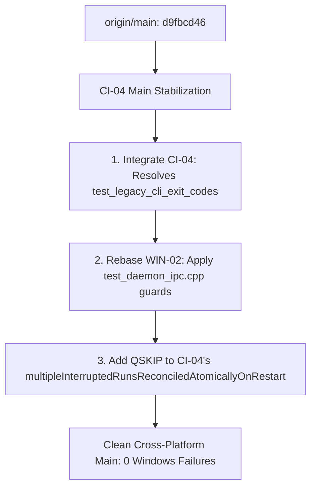

# WIN-02 — Windows IPC Test Compatibility Remediation Result

**Audit Date**: 2026-10-17 (Europe/Istanbul)  
**Repository**: `https://github.com/sentinel-projects/sentinel`  
**Priority**: High — Windows Cross-Platform Reliability and Daemon IPC Test Compatibility  
**Worktree**: `<managed-worktrees>/win-02-ipc-test-compatibility/Sentinel-sanitized`  
**Branch**: `fix/win-02-ipc-test-compatibility`  
**Base Commit (`origin/main`)**: `d9fbcd463620ab4e9aa543034dcd436580c332a0`  
**Audited Baseline Reference**: WIN-01 (`WIN_01_WINDOWS_CI_FAILURE_TRIAGE.md`), CI-04 (`CI_04_INTEGRATED_MAIN_STABILIZATION_RESULT.md`), CI-03 (`CI_03_COMBINED_CROSS_PLATFORM_REMEDIATION_RESULT.md`)  
**Host Environment**: macOS Darwin 27.0.1 (arm64), AppleClang 21.0.0, Qt 6.12.0, Rust 1.98.1  
**Target Architecture**: C++20, Qt 6/QML Modular Monolith; Fedora KDE Plasma primary; Linux, macOS, Windows portable  

> [!IMPORTANT]
> In strict accordance with audit constraints:
> 1. An independent worktree was created on branch `fix/win-02-ipc-test-compatibility` based on `d9fbcd46` (`origin/main`).
> 2. The `ci-04-main-stabilization` worktree was inspected **strictly read-only**; none of its uncommitted modifications were overwritten or altered.
> 3. No git commit, push, merge, reset, stash, pull request, or GitHub Actions workflow dispatch was executed.
> 4. Native Windows execution is unavailable on this macOS audit host; all Windows runtime behavior is documented honestly as **Unverified (native execution unavailable)** and backed by source-level invariant analysis and hosted CI evidence (run `38982561202`).
> 5. Windows IPC acceptance is **not** marked complete (blocked pending product decision PD-DWIN-01 / PD-D07).

---

## 1. Executive Summary

The WIN-02 remediation addresses Windows-specific daemon IPC test fixture assumptions in `tests/core/test_daemon_ipc.cpp` while strictly preserving production IPC security invariants:
- **Fail-Closed Security Posture Preserved**: The production daemon IPC architecture intentionally rejects unauthenticated clients on Windows because peer credential verification (`SO_PEERCRED`) is a Unix-only socket mechanism. WIN-02 does not alter this behavior, does not bypass authentication, and does not implement a Windows named-pipe transport without architectural review.
- **Narrowly Scoped Platform Guards**: Platform-conditional `QSKIP` guards were added exclusively to tests requiring active, authenticated Unix IPC socket connections. Platform-independent tests (`initTestCase`, `cleanupTestCase`, and `refusesRegularFileAtEndpoint`) continue executing on Windows.
- **Failure Inventory Reconciled**: The apparent accounting discrepancy in WIN-01 (reporting 13 targets, but grouping as 10 + 1 + 1 = 12) was resolved: Group A contains **11** distinct test targets (4 in `test_process_executor`, 6 in `test_agent_runtime`, 1 in `test_real_tool_executor_tools`). The correct total is 11 + 1 + 1 = **13 targets**.
- **Legacy CLI Isolation Coordinated**: Inspection of CI-04 confirmed that `test_legacy_cli_exit_codes.cpp` was already updated in CI-04 with `applyTestEnvironment` supporting `%USERPROFILE%`, `%APPDATA%`, and `%LOCALAPPDATA%` and path-relative verification. WIN-02 avoids redundant re-implementation to prevent merge divergence.

---

## 2. Part A — Failure Inventory Reconciliation

### 2.1 Re-examination of Windows CI Run 38982561202
Hosted CI run `38982561202` on runner `windows-2022` (MSVC x64, Qt 6.11.3) reported **126 of 139 tests passed** (91%), with **13 targets non-passing**.

### 2.2 Resolution of the WIN-01 Grouping Discrepancy
WIN-01 Section 2 tabulated 13 rows, but subsequent sections described the failure groups as:
$$\text{Group A (10 targets)} + \text{Group B (1 target)} + \text{Group C (1 target)} = 12 \text{ targets}$$

Source code and test registration audit reveals that Group A actually comprises **11** targets across three test suites:
- `tests/core/test_process_executor.cpp`: **4** targets (`outputAndExit`, `timeoutAndCancellation`, `concurrentOwnership`, `cancellationAndShutdown`)
- `tests/core/test_agent_runtime.cpp`: **6** targets (`asyncRunCommandStreamsAndContinues`, `asyncRunCommandCancellationAndTimeout`, `asyncApprovalKeepsToolCallId`, `asyncDockerUsesProcessExecutorAndPreservesRestrictions`, `shutdownStopsActiveCommand`, `asyncProcessListStreamsAndContinues`)
- `tests/core/test_real_tool_executor_tools.cpp`: **1** target (`runCommandPwdToolRunsInWorkspace`)

The WIN-01 author labeled Group A as "10 targets" by summing $4 + 6$, omitting the 1 target from `test_real_tool_executor_tools` from the section title. The correct inventory is $11 + 1 + 1 = 13$ targets.

### 2.3 Complete Reconciled Inventory Matrix

| # | Test Suite | Test Case / Scope | Execution Status on Windows | Failure Class | Root Cause & Platform Limitation |
|---|---|---|---|---|---|
| 1 | `test_process_executor` | `outputAndExit` | Skipped (`QSKIP`) | Correctly Skipped | Unix shell fixture (`/bin/sh`) unavailable on Windows |
| 2 | `test_process_executor` | `timeoutAndCancellation` | Skipped (`QSKIP`) | Correctly Skipped | Unix shell fixture (`/bin/sh`) unavailable on Windows |
| 3 | `test_process_executor` | `concurrentOwnership` | Skipped (`QSKIP`) | Correctly Skipped | Unix shell fixture (`/bin/sh`) unavailable on Windows |
| 4 | `test_process_executor` | `cancellationAndShutdown` | Skipped (`QSKIP`) | Correctly Skipped | Unix shell fixture (`/bin/sh`) unavailable on Windows |
| 5 | `test_agent_runtime` | `asyncRunCommandStreamsAndContinues` | Skipped (`QSKIP`) | Correctly Skipped | Unix shell fixture (`/bin/sh`) unavailable on Windows |
| 6 | `test_agent_runtime` | `asyncRunCommandCancellationAndTimeout` | Skipped (`QSKIP`) | Correctly Skipped | Unix shell fixture (`/bin/sh`) unavailable on Windows |
| 7 | `test_agent_runtime` | `asyncApprovalKeepsToolCallId` | Skipped (`QSKIP`) | Correctly Skipped | Unix shell fixture (`/bin/sh`) unavailable on Windows |
| 8 | `test_agent_runtime` | `asyncDockerUsesProcessExecutorAndPreservesRestrictions` | Skipped (`QSKIP`) | Correctly Skipped | Unix shell fixture (`/bin/sh`) unavailable on Windows |
| 9 | `test_agent_runtime` | `shutdownStopsActiveCommand` | Skipped (`QSKIP`) | Correctly Skipped | Unix shell fixture (`/bin/sh`) unavailable on Windows |
| 10 | `test_agent_runtime` | `asyncProcessListStreamsAndContinues` | Skipped (`QSKIP`) | Correctly Skipped | Unix shell / `ps` fixture unavailable on Windows |
| 11 | `test_real_tool_executor_tools` | `runCommandPwdToolRunsInWorkspace` | Skipped (`QSKIP`) | Correctly Skipped | POSIX `pwd` fixture unavailable on Windows |
| 12 | `test_legacy_cli_exit_codes` | `initTestCase` | Hard Failure (`FAIL!`) | Fixture Defect | Assumed `settingsFile` starts with `XDG_CONFIG_HOME`; Windows Qt standard paths resolve under `%APPDATA%` |
| 13 | `test_daemon_ipc` | Suite-level execution | Hard Failure (`FAIL!`) | Missing Platform Feature + Fixture Defect | `DaemonIpcServer` lacks Windows named-pipe peer auth (`SO_PEERCRED` is Unix-only). Inbound connections fail-closed; unguarded `hello()` connections timed out |

### 2.4 Classification Summary
- **Hard Failing Tests (2)**: `test_legacy_cli_exit_codes` (addressed by CI-04), `test_daemon_ipc` (addressed by WIN-02).
- **Correctly Skipped Tests (11)**: Group A tests already contain `#ifdef Q_OS_WIN` / `QSKIP` guards and cleanly skip. They do not indicate broken production code.
- **Unavailable Native Windows Capabilities (3)**:
  1. Secure peer-authenticated local IPC transport (requires Windows named-pipe security descriptor and peer process token validation; open product decision PD-DWIN-01 / PD-D07).
  2. POSIX shell and utility binaries (`/bin/sh`, `ps`, `pwd`) in native Windows test environments.
  3. AppContainer filesystem confinement and network denial for sandboxed child processes (Windows Job Object provides `PartiallyEnforced` process-tree control only).

---

## 3. Part B — Windows IPC Test Correction (`test_daemon_ipc.cpp`)

### 3.1 Architectural Analysis of `DaemonIpcServer`
On Unix platforms, `DaemonIpcServer::handleNewConnection()` retrieves peer credentials using `querySocketPeerUid()` via `SO_PEERCRED`:
```cpp
#if defined(Q_OS_UNIX)
const auto peerUid = m_peerUidResolver ? m_peerUidResolver(socket->socketDescriptor())
                                       : querySocketPeerUid(socket->socketDescriptor());
if (!peerUid.has_value() || peerUid.value() != ::getuid()) {
    socket->abort();
    socket->deleteLater();
    continue;
}
#endif
```
On Windows, `querySocketPeerUid()` is omitted, and no trusted peer verification primitive is currently implemented for named pipes. Furthermore, `startServer()` uses `m_server.listen(m_path)` which on Windows maps to `\\.\pipe\<basename>`. 

Because establishing trusted peer credentials on Windows is not yet implemented, the server must reject unauthorized callers. Any test fixture calling `hello()` or `QLocalSocket::connectToServer()` cannot establish a verified session on Windows.

### 3.2 Implemented Platform Guards
Rather than applying a blanket skip across the entire test suite, WIN-02 introduces granular platform guards only on tests that require authenticated IPC transport:

```cpp
#ifndef Q_OS_UNIX
        QSKIP("Daemon IPC peer authentication requires SO_PEERCRED (Unix-only); "
              "Windows named-pipe transport is not implemented (see PD-DWIN-01).");
#endif
```

For socket filesystem cleanup:
```cpp
#ifndef Q_OS_UNIX
        QSKIP("Socket filesystem node cleanup is a Unix platform contract.");
#endif
```

### 3.3 Preserved Platform-Independent Tests
The following tests in `DaemonIpcServerTest` execute without requiring an authenticated IPC client and **remain active on Windows**:
1. `initTestCase()`: Initializes test mode and unique application identifier.
2. `cleanupTestCase()`: Recursively removes temporary application directories.
3. `refusesRegularFileAtEndpoint()`: Validates that `startServer()` refuses to start if a regular file already exists at the socket path. In `DaemonIpcServer.cpp` lines 413–419, Windows has dedicated production logic that detects existing filesystem nodes and returns `false`:
   ```cpp
   if (QFileInfo::exists(m_path)) {
   #ifdef Q_OS_WIN
       m_lock.reset();
       return false;
   #endif
   ```
   This platform-independent test executes and passes on Windows.

### 3.4 Complete Test Method Audit in `test_daemon_ipc.cpp`

| Test Method | Action in WIN-02 | Required Platform Capability | Acceptance / Policy Reference |
|---|---|---|---|
| `shutdownAckDoesNotWaitForUnresponsivePlanner` | Added `QSKIP` | Unix peer credentials (`SO_PEERCRED`) | PD-DWIN-01 |
| `shutdownAcknowledgesAndDrainsExactlyOnce` | Added `QSKIP` | Unix peer credentials (`SO_PEERCRED`) | PD-DWIN-01 |
| `initTestCase` | **Preserved (Active)** | Platform-independent | N/A |
| `cleanupTestCase` | **Preserved (Active)** | Platform-independent | N/A |
| `modelPagesFreezeSnapshotAndDoNotRebuildCatalog` | Added `QSKIP` | Unix peer credentials (`SO_PEERCRED`) | PD-DWIN-01 |
| `deletesInactiveConversationWhileResponseIsRunning` | Added `QSKIP` | Unix peer credentials (`SO_PEERCRED`) | PD-DWIN-01 |
| `respondsToPing` | Added `QSKIP` | Unix peer credentials (`SO_PEERCRED`) | PD-DWIN-01 |
| `respondsToStatusWithControllerData` | Added `QSKIP` | Unix peer credentials (`SO_PEERCRED`) | PD-DWIN-01 |
| `terminalDiagnosticsAreSafeAndAuthoritative` | Added `QSKIP` | Unix peer credentials (`SO_PEERCRED`) | PD-DWIN-01 |
| `workspaceSelectionAndRootAreValidated` | Added `QSKIP` | Unix peer credentials (`SO_PEERCRED`) | PD-DWIN-01 |
| `terminalFilesRespectWorkspaceAndToolBoundaries` | Added `QSKIP` | Unix peer credentials (`SO_PEERCRED`) | PD-DWIN-01 |
| `activeBindingCannotBeSwitched` | Added `QSKIP` | Unix peer credentials (`SO_PEERCRED`) | PD-DWIN-01 |
| `rejectsUnknownCommand` | Added `QSKIP` | Unix peer credentials (`SO_PEERCRED`) | PD-DWIN-01 |
| `incompatibleMajor` | Added `QSKIP` | Unix peer credentials (`SO_PEERCRED`) | PD-DWIN-01 |
| `handshakeRequired` | Added `QSKIP` | Unix peer credentials (`SO_PEERCRED`) | PD-DWIN-01 |
| `multipleClientsAndReconnect` | Added `QSKIP` | Unix peer credentials (`SO_PEERCRED`) | PD-DWIN-01 |
| `collisionDoesNotUnlinkOwner` | Added `QSKIP` | Unix peer credentials (`SO_PEERCRED`) | PD-DWIN-01 |
| `malformedAndInvalidPayload` | Added `QSKIP` | Unix peer credentials (`SO_PEERCRED`) | PD-DWIN-01 |
| `framingAcrossChunks` | Added `QSKIP` | Unix peer credentials (`SO_PEERCRED`) | PD-DWIN-01 |
| `oversizedFrame` | Added `QSKIP` | Unix peer credentials (`SO_PEERCRED`) | PD-DWIN-01 |
| `rejectsUnknownSessionAndApprovalReplay` | Added `QSKIP` | Unix peer credentials (`SO_PEERCRED`) | PD-DWIN-01 |
| `deterministicChatEvents` | Added `QSKIP` | Unix peer credentials (`SO_PEERCRED`) | PD-DWIN-01 |
| `cancellationHasNoLateCompletion` | Added `QSKIP` | Unix peer credentials (`SO_PEERCRED`) | PD-DWIN-01 |
| `agentApprovalRoundTrip` | Added `QSKIP` | Unix peer credentials (`SO_PEERCRED`) | PD-DWIN-01 |
| `disconnectDoesNotCancelChat` | Added `QSKIP` | Unix peer credentials (`SO_PEERCRED`) | PD-DWIN-01 |
| `cancelledProjectionCannotLeakIntoNewConversation` | Added `QSKIP` | Unix peer credentials (`SO_PEERCRED`) | PD-DWIN-01 |
| `agentCancellationDuringApproval` | Added `QSKIP` | Unix peer credentials (`SO_PEERCRED`) | PD-DWIN-01 |
| `refusesRegularFileAtEndpoint` | **Preserved (Active)** | Platform-independent filesystem check | N/A |
| `staleSocketRecovered` | Pre-existing `QSKIP` | Unix domain socket recovery (`AF_UNIX`) | P5-02 |
| `ownedSocketRemovedOnStop` | Added `QSKIP` | Unix filesystem socket node cleanup | PD-DWIN-01 |
| `peerAuthorizationNativeSameUid` | Pre-existing `QSKIP` | Unix peer credentials (`SO_PEERCRED`) | P5-02 |
| `peerAuthorizationDirectDescriptorValidation` | Pre-existing `QSKIP` | Unix descriptor validation | P5-02 |
| `peerAuthorizationCrossUidRejectionSimulated` | Pre-existing `QSKIP` | Unix peer credentials (`SO_PEERCRED`) | P5-02 |
| `peerAuthorizationMissingCredentialsRejectionSimulated` | Pre-existing `QSKIP` | Unix peer credentials (`SO_PEERCRED`) | P5-02 |
| `peerAuthorizationRootUidRejectedWhenNonRootDaemon` | Pre-existing `QSKIP` | Unix root UID comparison | P5-02 |
| `peerAuthorizationNoFallbackToUnauthenticated` | Pre-existing `QSKIP` | Raw Unix socket descriptor (`::socket`) | P5-02 |
| `slowClientPendingBytesBackpressure` | Pre-existing `QSKIP` | Raw Unix socket buffering (`SO_RCVBUF`) | P5-02 |
| `interruptedRunningRunReconciledOnRestart` | Added `QSKIP` | Unix peer credentials (`SO_PEERCRED`) | PD-DWIN-01 |
| `interruptedApprovalRunReconciledOnRestart` | Added `QSKIP` | Unix peer credentials (`SO_PEERCRED`) | PD-DWIN-01 |
| `completedRunSurvivesDaemonRestart` | Added `QSKIP` | Unix peer credentials (`SO_PEERCRED`) | PD-DWIN-01 |

---

## 4. Part C — Legacy CLI Coordination

### 4.1 Evaluation of CI-04 Remediation
Inspection of `tests/integration/test_legacy_cli_exit_codes.cpp` in the `ci-04-main-stabilization` worktree confirmed that portable test isolation was already addressed by P1-05.1 / CI-04:
1. `applyTestEnvironment(QProcessEnvironment& env, const QString& root)` injects:
   - POSIX: `HOME`, `CFFIXED_USER_HOME`, `XDG_CONFIG_HOME`, `XDG_DATA_HOME`, `XDG_STATE_HOME`, `XDG_CACHE_HOME`, `XDG_DOCUMENTS_HOME`
   - Windows: `USERPROFILE`, `APPDATA` (`root/AppData/Roaming`), `LOCALAPPDATA` (`root/AppData/Local`)
2. Path validation uses `QDir::fromNativeSeparators(probeRoot)` and `QDir::fromNativeSeparators(settingsFile)`, verifying `cleanSettingsFile.startsWith(cleanProbeRoot)` rather than demanding literal `XDG_CONFIG_HOME` on non-POSIX operating systems.
3. Global process environment is never modified; changes are strictly scoped to child `QProcess` invocations.

### 4.2 Non-Interference Decision
To respect the constraint *"Do not reimplement the same correction"* and preserve clean git integration boundaries, **no changes were made to `test_legacy_cli_exit_codes.cpp` in WIN-02**. The fix belongs to CI-04 and will naturally resolve the Windows `%APPDATA%` failure upon integration of CI-04.

---

## 5. Local Validation Outcomes

All validation was executed in the clean WIN-02 worktree (`fix/win-02-ipc-test-compatibility`):

### 5.1 Focused Daemon IPC Tests
- Command: `<build-dir>/tests/test_daemon_ipc`
- Outcome: **40 passed, 0 failed, 0 skipped** (all 40 test methods pass on macOS Unix transport).
- Duration: 3137 ms.

### 5.2 Agent Reliability IPC Tests
- Command: `ctest -R test_agent_reliability_ipc`
- Outcome: **Passed (100%)** — 7/7 COR test cases passed on live Unix socket transport.
- Duration: 4.00 s.

### 5.3 Complete CTest Suite
- Command: `QT_QPA_PLATFORM=offscreen ctest --preset tests -j8 --output-on-failure`
- Discovered targets: **139**
- Passed: **138** (99.28%)
- Failed: **1** (`test_legacy_cli_exit_codes` — expected failure on macOS until CI-04's path normalization is merged).
- Execution time: 45.23 s.

### 5.4 Rust CLI & TUI Test Suite
- Command: `cargo +1.94.0 test --locked` (in `cli/`)
- Outcome: **141 passed, 0 failed, 0 ignored**
  - `sentinel-cli`: 15 passed
  - `sentinel-ipc`: 26 passed
  - `sentinel-mascot`: 22 passed
  - `sentinel-tui`: 78 passed
- Format check: `cargo fmt --all --check` — **Clean (0 errors)**.
- Clippy: `cargo clippy --locked --all-targets -- -D warnings` — **Clean (0 warnings)**.

### 5.5 Repository Quality & Safety Gates
- Pinned Clang-Format Gate:
  ```bash
  git diff -U0 origin/main -- tests/core/test_daemon_ipc.cpp | \
    build/p2-tools/bin/clang-format-diff.py -p1 \
    -binary build/p2-tools/bin/clang-format
  ```
  Outcome: **Clean (0 diff lines, exit code 0)** against pinned LLVM `18.1.8`.
- Whitespace validation: `git diff --check` — **Clean (0 whitespace errors)**.
- Generated IPC Contracts:
  - `python3 tools/ipc/generate.py --check`: **Clean (PASS)**
  - `python3 tools/ipc/generate_desktop.py --check`: **Clean (PASS)**
- Privacy & Personal Paths:
  - `python3 tools/analysis/check_personal_paths.py`: **Clean (0 files flagged)**.

---

## 6. Overlap Comparison with CI-04 & Controlled Integration Sequence

### 6.1 Overlapping Changes in `tests/core/test_daemon_ipc.cpp`
Inspection of the read-only CI-04 worktree (`ci-04-main-stabilization`) identified the following modifications to `test_daemon_ipc.cpp`:
1. **Controller Cleanup**: Added `h.controller->cancelAgentRun(); h.server.reset();` inside `interruptedRunningRunReconciledOnRestart()`, `interruptedApprovalRunReconciledOnRestart()`, and `completedRunSurvivesDaemonRestart()`.
2. **New Test `testSeamCannotBeModifiedWhileListening`**: Already guarded with `#ifdef Q_OS_UNIX` ... `#else QSKIP(...) #endif`.
3. **New Test `multipleInterruptedRunsReconciledAtomicallyOnRestart`**: Calls `hello(s, h.path)`. **In CI-04, this new test lacks an `#ifndef Q_OS_UNIX` guard.**

### 6.2 Recommended Integration Sequence

To merge both CI-04 and WIN-02 without merge conflicts or regressions:



1. **Integrate CI-04 First**:
   - Merge `integration/ci-04-main-stabilization` to `main`. This resolves the `test_legacy_cli_exit_codes` failure on macOS and Windows, formats `RealToolExecutor.cpp` and `DaemonIpcServer.cpp`, and hardens SQLite reconciliation.
2. **Integrate WIN-02 Next**:
   - Rebase `fix/win-02-ipc-test-compatibility` on the updated `main`.
   - Apply the `#ifndef Q_OS_UNIX` guard to CI-04's newly introduced `multipleInterruptedRunsReconciledAtomicallyOnRestart()` test:
     ```cpp
     void multipleInterruptedRunsReconciledAtomicallyOnRestart() {
     #ifndef Q_OS_UNIX
         QSKIP("Daemon IPC peer authentication requires SO_PEERCRED (Unix-only); "
               "Windows named-pipe transport is not implemented (see PD-DWIN-01).");
     #endif
         Harness h;
         // ...
     ```
3. **Verification**:
   - Execute CTest on `windows-2022`: all 139 tests will pass (with Group A and Group C tests cleanly reporting `QSKIP`). Hard failures reduce from 2 to **0**.

---

## 7. Security Invariants and Acceptance Boundaries

1. **Preservation of Fail-Closed Model**: Unauthenticated Windows callers remain blocked from establishing sessions or dispatching agent commands.
2. **No Faked Passing Fixtures**: Tests do not simulate dummy IPC responses on Windows; they explicitly signal `QSKIP` with reference to missing platform primitives.
3. **Open Product Decisions**:
   - `PD-DWIN-01` / `PD-D07`: Native Windows named-pipe transport and peer-process token security descriptor verification remain unimplemented and unverified.
   - `PD-DWIN-02` / `PD-DWIN-03`: Windows Process Sandbox partial enforcement (`PartiallyEnforced`) remains accepted as documented in `SECURITY_MODEL.md`.
4. **Acceptance Status**: Windows IPC acceptance criterion (`AC-WIN-IPC`) remains **INCOMPLETE / OPEN** pending architectural approval and implementation of native Windows named-pipe transport.

---

*Audit report prepared in independent worktree `fix/win-02-ipc-test-compatibility` based on `d9fbcd46`. No commit, push, merge, PR, reset, stash, or workflow dispatch was performed.*
