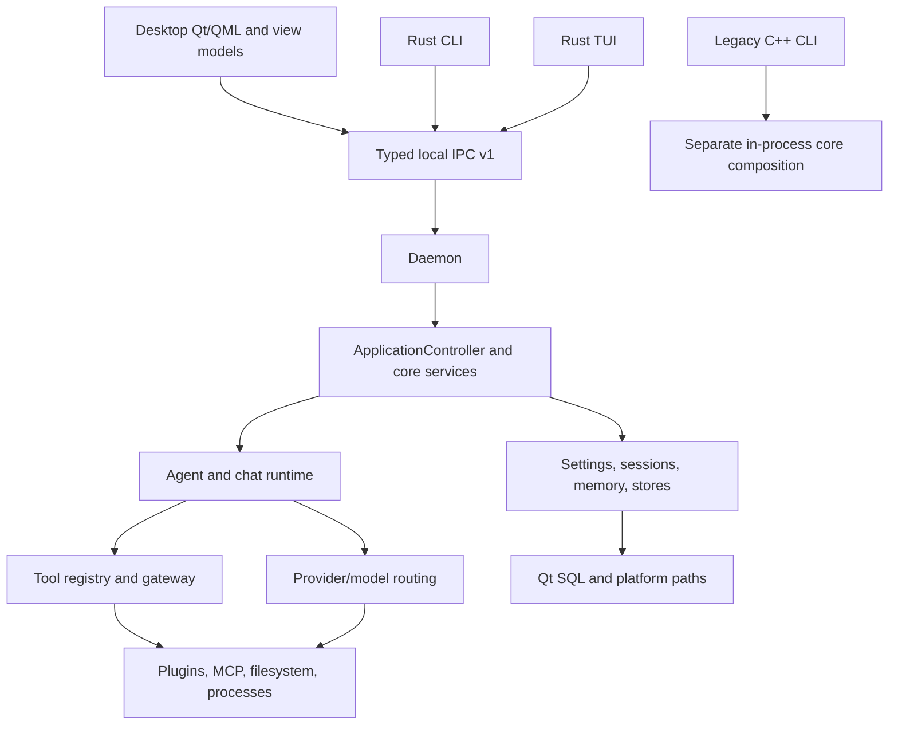

# Architecture

Sentinel is a C++20/Qt 6 modular monolith. Desktop, CLI, daemon, and plugin host are executable surfaces over the `sentinel_core` static library.

`apps/sentinel-desktop` owns the Qt/QML shell and bootstrap. QML is presentation; `DesktopShellViewModel` and related view models expose safe state and actions. `apps/sentinel-cli` is a partial, small command dispatcher. `apps/sentinel-daemon` is the headless production runtime authority for Desktop and Rust CLI/TUI clients: it composes existing core services through the same builder and exposes versioned local IPC for sessions, Chat, Agent, approvals and cancellation. Production Desktop is a daemon-backed IPC client with separate local presentation preferences. Its Quick Panel shares the existing DesktopRuntimeClient; NativeCompanionAdapter owns platform activation, tray, shortcuts and lifecycle. Desktop can launch a detached daemon through `ApplicationBootstrapper::ensureBackgroundDaemon` when needed; safe mode and `--no-daemon-start` suppress this attempt. Process launching does not transfer execution ownership to Desktop: it constructs no in-process ApplicationController fallback. Rust clients require an externally started daemon. The legacy C++ CLI retains a separate in-process composition path. See [daemon development](DAEMON.md) and [IPC](../interfaces/IPC.md). `apps/sentinel-plugin-host` supports the experimental plugin-host protocol.

`core/` owns the shared application controller and domain services. Agent work flows through `AgentRuntime`/`AgentLoop`, with `LlmAgentRuntime` supplying LLM step decisions and `ControlledTaskService` projecting controlled tasks through the same runtime; provider behavior through `IChatProvider` and `IModelRouter`; tools through `IToolRegistry`, `ToolDescriptor`, and `ToolExecutionGateway`. `IFileSystemService` and `ProcessExecutor` isolate system-facing tools. Platform functionality belongs behind interfaces such as `IPathProvider`, `IPlatformService`, and `ISystemIntegrationService`.

Persistence remains split: settings use `ISettingsStore`; memory uses `IMemoryStore`; history and conversations use their own stores; permission grants and agent runs have separate SQLite stores. Qt SQL is the SQLite path. Core should not depend on QML presentation or platform-only behavior.

The concurrency model uses Qt signals/events for UI and provider integration; agent execution scheduling and loop events keep active work observable and cancellable. See [Agent Runtime](../concepts/AGENT_RUNTIME.md) for run semantics. These components are implemented; reliable real-model task completion remains unaccepted.

Hardware capability facts and model-fit estimates exist, but a continuous CPU/RAM/GPU pressure-driven adaptive resource policy is not implemented. Linux/KDE global Quick Panel shortcut registration is unavailable; daemon clipboard tools require a GUI and are unavailable in the headless process; Linux application launching is explicitly unsupported. Native platform behavior remains subject to acceptance, including Rust Windows named-pipe transport, which is not implemented. Public distribution blockers remain in the [SEC-P1 register](SEC_P1_4_GITHUB_HARDENING_REPORT.md#5-consolidated-blocker-register).
