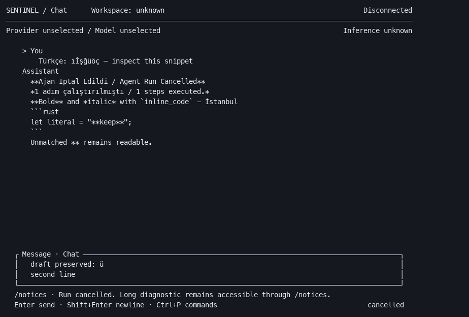
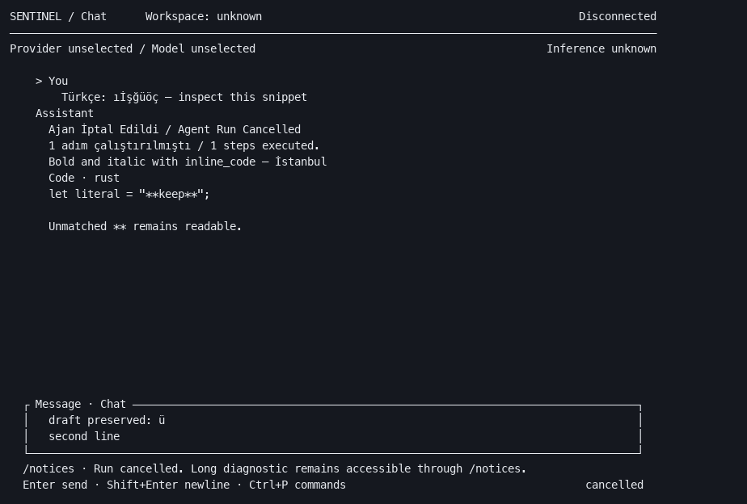

# SENTINEL — TUI V3.3-A UX COMPLETION REPORT

2026-10-11. **Scoped presentation fixes implemented and deterministically verified. Physical terminal acceptance: NOT VALIDATED.**

## Reproduced defects and fixes

| Defect | Exact change | Component |
|---|---|---|
| Cancelled assistant answers show literal `**` and `*`, including the Turkish cancellation wrapper omitted by the earlier failure-only normalization | Render balanced bold, italic and single-backtick code as styled spans; retain unmatched/unsupported syntax verbatim | Rust TUI `transcript_lines`, `inline_markdown` |
| Transcript wrapping flattened every span into one style | Slice the original spans at the existing UTF-8/cell-width wrap boundaries; follow/scroll use the same rows | `wrap_transcript`, `styled_slice` |
| Fenced code exposes raw fence delimiters | Display a `Code · language` label and a blank closing separator; preserve code body literally | `transcript_lines` |
| A cancel acknowledgement arriving after a terminal event could restore `cancelling` and waiting text | Apply acknowledgement only while the current state is active; completed/failed/cancelled states retain their terminal notice | `App::update` |
| CRLF/CR-only pasted text retains carriage returns instead of editable lines | Normalize paste line endings to LF before insertion; preserve literal slash-paste behavior and input bound | `editor::Editor::paste` |

Canonical daemon content, export and IPC remain unchanged. User messages, execution details and code bodies remain literal. The centered reading column, role labels, themes, command registry and keyboard contract remain intact. Existing footer ellipsis plus `/notices` retains access to long diagnostics. No additional verified composer, picker or theme defect justified redesign.

## Validation

- Rust workspace: **79 tests pass** (CLI 14, IPC 11, TUI 54). Final scoped TUI rerun: **54 pass**. Four additional tests cover paste line endings, late cancel acknowledgement, styled wrapping/content fidelity and the evidence matrix.
- Workspace formatting, Clippy with `-D warnings`, debug and release builds: **PASS**. Initial Clippy collapsible-if warning was corrected. The first fallback evidence export failed because its output directory was absent; creating that directory and rerunning succeeded.
- Render matrix: **80×24, 100×30, 120×40, 160×48**, each with Terminal, Obsidian, Glacier and Porcelain; repeated under ASCII/NO_COLOR. Existing tests also cover compact grids, long transcript follow positioning, deterministic streaming/final replacement, notice access, focus, search, pickers, help, unavailable commands, newline keys and draft preservation.
- **8 offline PTY journeys**: four sizes, normal and ASCII/NO_COLOR. Repository-local release CLI, command palette open/Escape, bracketed multiline Turkish paste, Ctrl+O, Ctrl+C draft preservation and idle exit. All clean exit; replay confirms `/literal`, `Türkçe` and `draft` survive. Offline reconnect notices can replace the transient draft-preserved notice; the draft remains intact.
- No live model/Agent benchmark, C++ change or full C++ suite. Existing dirty C++ work and concurrent Core Warden files were preserved. Personal-Brain executable was unavailable; repository resolution used the user-provided workspace.

## Before/after evidence

Identical deterministic fixture, original versus updated renderer:

| Before | After |
|---|---|
|  |  |

These PNGs render **TestBackend text snapshots**, not native screenshots; they demonstrate layout and visible content, not terminal font modifiers/colors. Styled spans are asserted by unit tests. All 48 text snapshots, eight ANSI PTY captures/replays, scripts and executable SHA-256 are in [evidence](../reviews/tui-v33a/README.md). Historical raw-cancellation visual evidence was also inspected in the V3.2.5 captures.

## Remaining limitations / V3.3-B recommendations

- This is a conservative Markdown subset, not CommonMark: nested emphasis, escapes, multiple-backtick inline syntax, tables, links and headings may remain literal. Partial streaming markup remains visible until balanced. Syntax highlighting is absent. Preserve unsupported content; assess a bounded Markdown parser separately if required.
- Composer long logical lines retain horizontal scrolling; grapheme-cluster editing and soft-wrap navigation remain future work. No new shortcuts or clipboard/OSC52 integration were added. Native terminal selection/copy is host-dependent; canonical export remains available.
- Physical terminal rendering, host-specific Shift+Enter, selection/copy and accessibility require observed acceptance. Terminal theme contrast depends on the host palette; fixed palettes were retained, not redesigned.
- Future V3.3-B may target those demonstrated interaction gaps after native observation. Agent reliability remains a separate workstream. No V3.3-B work was started; no commit, push or merge was issued.
